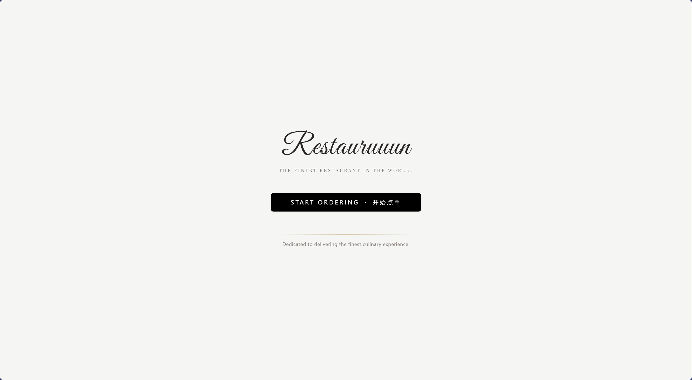
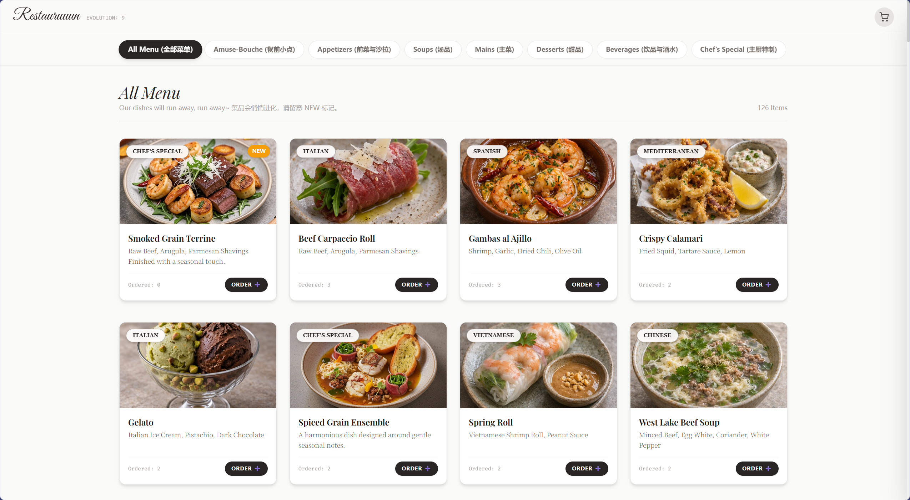
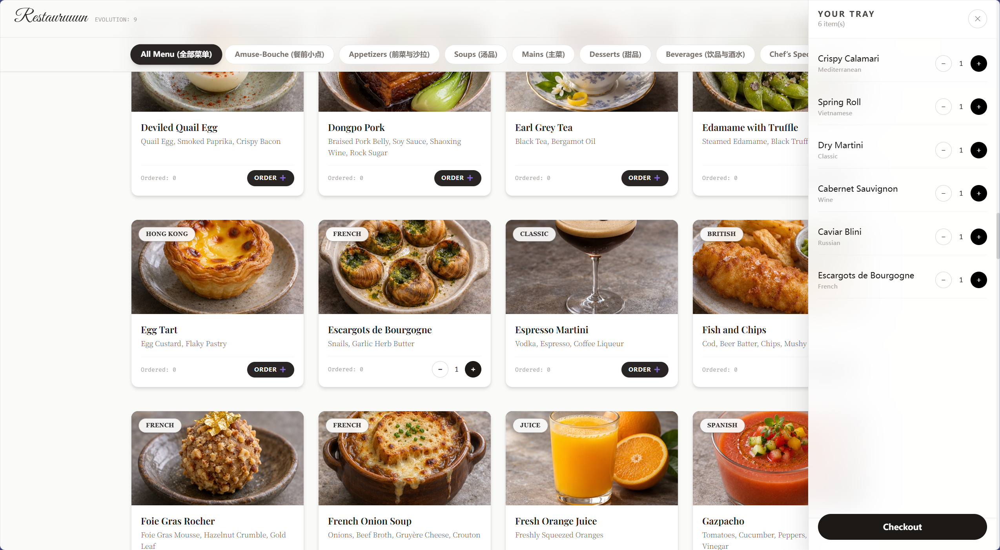
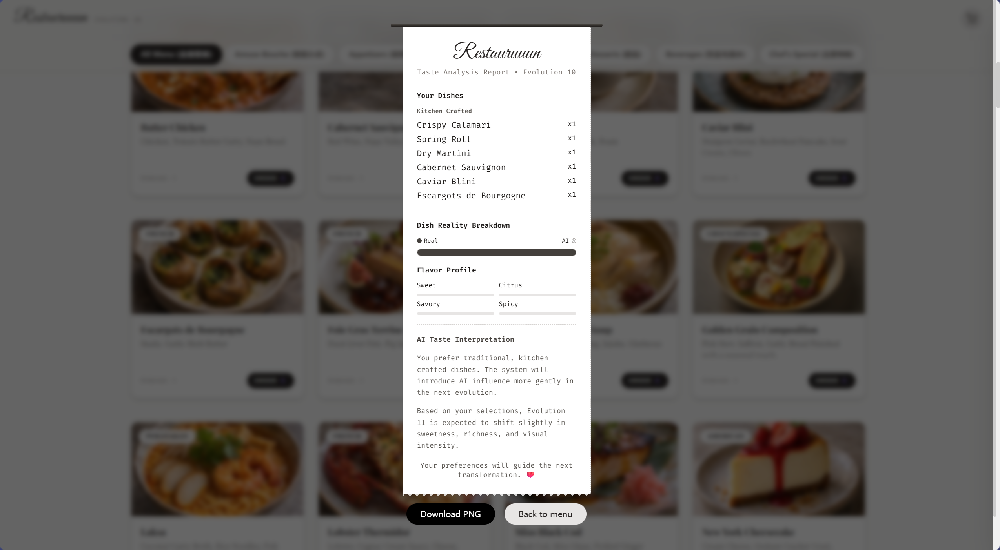

# Restauruuun
### 菜单会改变，你的选择也是。 / The menu changes. So do your choices.

[**进入互动餐厅 · Experience the restaurant →**](https://restauruuun-app.onrender.com/)

Restauruuun 是一件以高级餐厅点单界面为入口的互动网页作品。浏览、点单、查看分析，再开始下一轮：每一次选择都会参与塑造接下来出现的菜单。它邀请你思考：当系统越来越懂你的偏好，你还能注意到哪些选项正在消失吗？

Restauruuun is an interactive web artwork presented as a fine-dining ordering experience. Browse, order, review your choices, and return for another session. Each selection helps shape the next menu, asking: as a system learns your preferences, do you notice which alternatives disappear?

> 本仓库现已更新为 Next.js 完整项目，展示图由作者提供。 / This repository now contains the full Next.js application; images are supplied by the author.

## 01 · 浏览与选择 / Browse & choose

当前原型从 **126 道菜品**开始，涵盖餐前小点、前菜、汤、主菜、甜品和饮品六类，另有全部菜单视图。点击 ORDER 将菜品加入托盘；系统会根据点单次数、偏好的分类及算法生成标记调整排序。

The prototype starts with **126 dishes** across six categories: amuse-bouche, appetizers, soups, mains, desserts, and beverages, plus an all-menu view. Select ORDER to add a dish to your tray. Ordering frequency, category preferences, and generated-item status influence the menu ranking.

## 02 · 托盘 / Your tray

查看选择、调整数量并结算。 / Review selections, adjust quantities, and check out.

## 03 · 味觉报告 / Taste report

结算后查看小票式报告，返回菜单观察下一轮变化。 / Review the receipt-style report, then return to the menu to observe the next evolution.

## 04 · 为什么菜单会“跑掉”？ / Why does the menu “run away”?

作品把推荐系统的反馈循环变成一次可操作的餐厅体验：选择影响排序，排序影响可见性，后续轮次再改变可选菜品。算法菜名通过浏览器中的规则与随机组合生成；当前版本没有调用大语言模型来生成菜单或分析文本。

The work turns a recommendation feedback loop into a restaurant experience: choices affect ranking, ranking affects visibility, and later sessions change the available dishes. Algorithmic dish names are assembled using browser-side rules and random combinations; the current version does not call a large language model to generate menus or analysis text.

可以尝试连续几轮只点同一分类，再观察菜单的变化。  
Try choosing from the same category for several rounds and observe how the menu changes.

## 运行与部署 / Run & deploy

使用 Node.js，执行 `npm ci`、`npm run build`、`npm start`。开发模式使用 `npm run dev`。
Use Node.js and run `npm ci`, `npm run build`, and `npm start`. Use `npm run dev` for development.

原始菜品使用 `public/menu-images` 中的本地图片；新菜品通过服务端 Google Gemini 图片接口生成。将 `GEMINI_API_KEY` 配置为服务端环境变量，切勿提交密钥。
Original dishes use local photos in `public/menu-images`. New dishes use server-side Google Gemini image generation. Set `GEMINI_API_KEY` as a server environment variable; never commit credentials.

菜单演化和图片缓存保存于服务端 `.dish-images`。Render 免费实例的文件不会持久保存，重启或重新部署后演化状态与生成图片可能重置；空闲后首次访问也可能需要等待唤醒。
Evolution state and generated images are stored in server-side `.dish-images`. Files on Render's free instance are ephemeral and may reset on restart or redeploy. The first request after inactivity may need to wait for the service to wake up.

此目录是单独的部署副本，原始本地项目未作修改。
This is a separate deployment copy. The original local project is unchanged.
